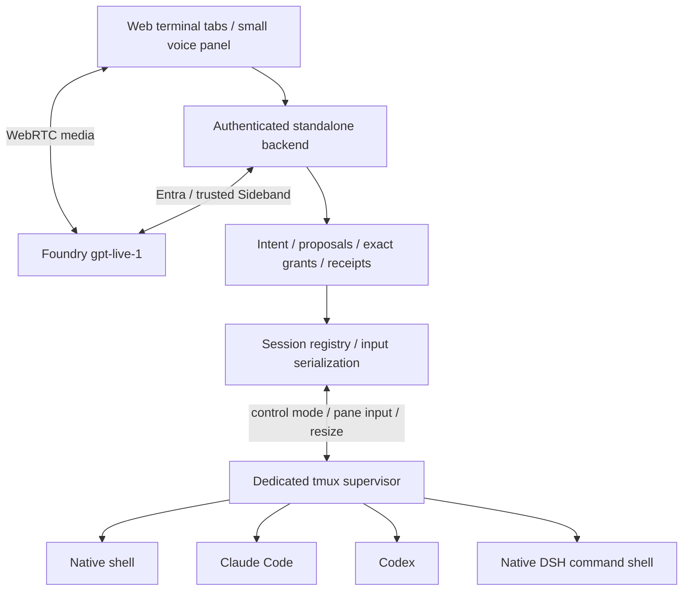

# ADR-0002: Independent Live Assistant and persistent terminal sessions

English | [简体中文](0002-independent-live-assistant.zh-CN.md)

- Date: 2026-10-12
- Status: Implemented; the real backend and the voice slice have been verified, but verification by a real human speaking Chinese and on physical devices is not yet complete.
- Supersedes: the earlier voice prototype hosted in DSH, with centralized dispatch through profiles and plugins (ADR-0001). That prototype was removed on 2026-10-14 (see "Third revision" at the end), before this repository's public history.

## Decision

A standalone Node web backend provides a workspace that is terminal-first, with voice in a supporting role. GPT-Live's WebRTC media and trusted Sideband control are implemented by `live.mjs` (`FoundryLive`), and the protocol details follow previously validated integration experience. DSH, Codex and Claude are native command executors on the same VM and are not routed through DSH subagents.

The already-installed **tmux 3.4** is chosen as the PTY and process supervisor. The web backend observes output through control mode on a dedicated socket, and interacts through real pane input and the window-size API. The tmux server is not tied to the lifecycle of the browser or the web backend; when the backend exits, only the observer stops and the panes are not terminated. We did not introduce node-pty plus a new resident supervisor, nor did we disguise a plain stdout pipe as a terminal.

| Option | Rationale |
|---|---|
| tmux + control mode | Already present on this machine; preserves the PTY, native shell/TUI, keyboard and mouse, process survival and reattachment; no new system service needed |
| node-pty + standalone supervisor | Feasible, but requires a new standalone supervisor process, protocol and lifecycle management; unnecessary in this round |
| Web backend directly owns plain child processes / output redirection | Does not meet the TUI/PTY requirement or the requirement for persistent execution after the web backend exits |

## Components and contracts

`Sessions` holds a stable UUID, the working directory, the harness type, the pane PID, a running/exited/lost state, an incrementing observation version and persistent operation receipts. A WebSocket client attaches to only one selected terminal; all sessions run independently. xterm/headless and serialize keep a bounded observation window, and xterm/browser provides native terminal operation. Reattachment uses a snapshot that marks any gap; keyboard input is not cached or replayed. A slow client is disconnected and then reattaches, without blocking the harness.

Multiple clients of the same user may observe; a session has only one keyboard/resize owner at a time. An explicit "take over keyboard" (`接管键盘`), actual keyboard input, a resize, an output change or a revocation of authorization invalidates earlier one-time decisions. Assistant input, user input and size changes are serialized; bulk text is sent separately from the submit key, for compatibility with native TUI paste detection.

The observer first attaches with `ignore-size`, then establishes a capture/cursor response boundary within the same control stream. Output before the boundary is not duplicated with the snapshot, and deltas after the boundary are applied in order, eliminating the loss window of a separate capture→attach. The observer does not change the PTY size of the owning user. Historical snapshots after termination no longer read the mouse flags of a pane that no longer exists. Keyboard UTF-8 and xterm `onBinary` mouse bytes are transmitted separately.

## Management and authorization

tmux 3.4 occasionally fails to report `pane_dead_status` after the native process has ended. The launcher shell therefore waits for the native command to exit and saves its actual return code, and the supervision layer reads this receipt first. When a process is forcibly terminated and no receipt exists, the status stays unknown; no zero exit code is fabricated. Full-screen reattachment restores the alternate buffer; mouse modes are restored from tmux's native flags, because a plain screen capture/xterm serialization does not fully carry these modes.

The GPT-Live delegation takes no parameters. A bounded, tool-free, structured Responses request using `gpt-6.1-sol` interprets the trusted conversation and the session catalog and forms a `new/input/append/modify/continue/verify/status/cancel/wait/pause/clarify` proposal. It is not a new general-purpose execution loop, nor does it depend on DSH/Flash. Interpretation errors block the operation. A status query creates no process, and is not rejected because of normal output changes during the read-only query.

Create/terminate proposals carry a UUID, a time limit and a target version; input on the user's behalf is further bound to the target session, the snapshot hash, the exact bytes, a 60-second time limit and an operation ID. A user button or an explicit spoken "confirm operation" (`确认操作`) / "reject operation" (`拒绝操作`) decides the currently valid request; the target is captured when the user's utterance begins. Assistant output, quotations, terminal text and silence never grant permission.

The user may choose a short-lived exact-input grant of at most three uses. It can be reused only for an identical snapshot and input, and each use first persists a prepared receipt before sending. User takeover, revocation, a resize, expiry or exhausting the uses ends the grant. The native harness's permissions/sandbox are not bypassed; Claude explicitly uses the native `default` permission mode, so that the default auto mode of newer versions does not change the existing human-confirmation boundary.

Terminal text such as `[y/N]` can only produce a "possibly awaiting confirmation" (`可能等待确认`) hint and a pending input that requires authorization; it is not treated as a native structured approval fact. Full-screen or other ambiguous prompts are handled by the user directly, or by explicitly asking the assistant to type; selection keys are not guessed. Pure terminal cross-process interaction cannot guarantee an atomic commit together with the CLI's state change, and this boundary must not be dressed up as a strong approval protocol.

Stopping speaking, muting or closing Live does not terminate the shell. wait means sending no input to the terminal and waiting for the user's feedback; it does not promise to freeze running work. Cancel explicitly closes the specified tmux session and checks whether the original pane and known child processes have actually exited; if child processes remain, it reports unknown rather than claiming success. A process exit code is not task verification, and "done" (`完成`) in the terminal is not an authoritative result.

An explicit, trusted spoken "wait for the user's feedback" (`等待用户意见`) / "wait for feedback" (`等待反馈`) / "pause the current session" (`暂停当前会话`) immediately revokes the automatic-input grant of the session that had focus when the utterance began; it is deduplicated within the same utterance and does not wait for intent inference. Creating a background session does not steal the user's focus. The catalog is synced in bounded fragments; each batch carries at most three background outputs, and the remaining sessions stay queued, so that a fourth one is not starved. Content fields passed to the model are redacted, while structured session/run associations and the user's raw terminal interaction are preserved.

## Managed runs and verification facts

A persistent processRunId represents the native process; each authorized append/modify/continue produces a managed run that keeps previousRunId and inputEpoch. An old run being superseded only describes the validity of its result; it does not fake an underlying cancellation. Native output carries observationId, sequence and revision, with taskRunId explicitly null, so that mixed terminal content is not forcibly attributed to the current task.

An independent command that the user explicitly provides and approves runs in a separate process group, bound to runId/inputEpoch; its result carries the actual exit code and passed/failed/unknown/stale. At most two run concurrently, limited to 30 seconds and 64 KiB of output, and the local coreutils timeout also enforces the limit if the web process exits abruptly. Exceeding a limit cleans up that run's process group; a repeated operation is not re-run, and a prepared result stays unknown after a restart. A late result cannot update the success status of a newer run; passed proves only that particular verification command, not general business success or the complete cost.

## Native model routing

> Superseded by the "Fourth revision" below; this section is kept only as a historical record.

At the time, read-only Foundry queries confirmed that the deployments for realtime voice, DeepSeek Flash, the Codex main model and the subagent model were available, with key authentication disabled. Real requests were checked separately, and resource state was not taken as evidence of successful inference.

The Codex/DSH wrapper itself held a short-lived routing proxy that listened only on loopback; the CLI environment received only a random local proxy authentication value. On each forward, the proxy obtained the current Entra token through AzureCliCredential, and never wrote the real token into configuration, arguments, the terminal or web responses. Configuration, the model list and routes could be written to disk; credentials stayed only in memory / the child-process environment.

- Codex 0.129.0: main model `gpt-6-astra`; the actual version used `agents.{default,worker,explorer}.config_file` and `description`, with the sub-configuration selecting `gpt-6.1-sol`. Real worker requests confirmed that both models returned HTTP 200. The `agents.default_subagent_model` on the official page at the time was incompatible with the installed version and could not be copied as-is.
- Codex request compression was on by default and the local proxy did not support zstd, so this existing feature was explicitly turned off, without changing the global user configuration.
- DSH 0.1.6-alpha.2 had no installed `tui` profile. The native `dsh "task"` command in a persistent bash, the headless profile and native session logs were used, without claiming a DSH TUI that did not exist. Foundry Flash rejected the official DeepSeek private metadata, so the upload contributions of `session-log-deepseek` and `plugin-package-inventory-deepseek` were turned off through native configuration, while local execution logs were kept.
- Claude 2.1.283: the current installing user was the same as the source-configuration user, so the original configuration was reused in place; when installing into a new home, the specified settings were copied safely and existing onboarding fields were preserved. A real launch kept the native trust/renderer/permission prompts; onboarding did not substitute for actual authentication.

Official configuration background: [Codex subagents](https://learn.chatgpt.com/docs/agent-configuration/subagents); configuration compatibility was determined by the local help output, error messages and real requests.

## Recovery, security and migration

A web backend restart re-observes existing tmux panes, revokes all old pending items/grants, and does not resubmit commands. When a tmux/VM restart means the original process no longer exists, the session is marked lost and only its history and catalog entry are kept. Metadata is not an execution checkpoint.

Loopback HTTP allows only an exact Host/Origin by default; external access goes through an authorized SSH tunnel or an HTTPS reverse proxy with an explicit origin. The password is in the process environment; the login cookie is kept in memory and is HttpOnly/SameSite; login and terminal/Live operations share the same authentication. Static assets are served locally, without a CDN.

The state directory defaults to `.live-assistant`. A state directory supports only one web backend writer, shared by multiple browsers. (The capacity limits of the first round were removed by the Second revision.)

## Second revision (2026-10-13): human in the loop

This section supersedes the conflicting limit, time-limit and use-count clauses above (the 60-second proposal time limit, grants of at most three uses, the two-concurrent/30-second/64 KiB verification limits, the model proxy request cap, the Live monthly budget, and the caps on the number of sessions/operations/receipts).

- **Positioning**: human in the loop; the user decides when to stop. There are no caps on execution count, item count or duration; only byte-level buffers that prevent crashes are kept. Attention problems are handled by proactive context compression (`condense` / `DeltaMemory` in `text.mjs`, which send only the changed catalog and new lines; the Live transcript folds older content).
- **Unified proposals**: `sessions.json` v2 stores `proposals` (input / prompt / permission / create / cancel / close / verify). They are numbered as "N.", cycling through 1–99, can coexist and can be decided in any order. The authorization epoch (`revision`) changes only on user takeover, wait for feedback or process exit; output and spinners do not invalidate proposals. On-screen confirmations are anchored to the question region and become invalid only when the prompt leaves the screen.
- **Always allow**: a session-level grant keyed by `(kind, key)`, with no use count and no time limit, cleared by revocation, wait for feedback or process exit.
- **Native hook**: the Claude Code / Codex `PermissionRequest` hook (`hook.mjs`) turns permission requests into proposals via `hook.sock`. On "handle in terminal" (`在终端处理`), when the socket is unavailable, or when the backend has exited, the hook prints nothing and exits 0, and the native prompt takes over.
- **Concurrency**: each session has its own serial queue; the global queue is used only for creation. Reconciliation uses a single `list-panes -a`; input goes through control-mode `send-keys -H`.
- **Event log**: `events.jsonl` appends the full history; `sessions.json` keeps only the recent working set.
- **Intent interpreter**: model calls run outside the queue; if the epoch has changed when the result is committed, this is only noted on the card and the request is not discarded. Usage is recorded, with no cap on calls.
- **Foundry facade**: `foundry.mjs` unifies Entra credentials, endpoint validation and TTS `createSpeech` (`/openai/v1/audio/speech`, default `gpt-4o-mini-tts`); the frontend can read new proposals aloud.
- **Verification**: configurable timeout (default 10 minutes), keeps the tail of the output, and can be cancelled.
- **Precedence between takeover and the assistant** (2026-10-15): deliberate human input (keystrokes, clicks, pastes, explicit takeover) takes precedence over assistant proposals and invalidates them; mouse movement/wheel events, focus events and responses generated automatically by the terminal are not human decisions and do not invalidate proposals. An explicit "hand back keyboard" (`交还键盘`) only releases ownership. Late voice decisions and failed interpretations both answer the corresponding delegation, instead of interrupting the voice turn with an error. On the page, cards take precedence over error messages.

## Third revision (2026-10-14): removing the old prototype

- Removed the old DSH-hosted voice prototype together with all of its code, scripts, tests, configuration and documentation: the 8 packages under `packages/` other than `live-assistant`, `profiles/voice`, the TypeScript build configuration, npm scripts such as `voice:legacy`/`demo`/the old browser tests, and configuration items such as `VOICE_*`, `FOUNDRY_RESOURCE_GROUP`, `FOUNDRY_ACCOUNT_NAME` and `FOUNDRY_REASONING_DEPLOYMENT`. The repository now has a single workspace, `packages/live-assistant`, and no build step is needed any more.
- The Live adapter previously imported from the old packages was replaced by `packages/live-assistant/src/live.mjs` (`FoundryLive`), which keeps only the capabilities this assistant uses: no retry on creation, `uncertain` recovery, reattach and close, commentary/thinking context, transcription and delegation events, and usage recorded per UTC month. Budgets, leases and usage caps were all removed; usage is only displayed. The state file changed from `live-lease.json` to `live.json`, and the old file is no longer read (all local records were already closed before the switch).
- npm scripts: `assistant`, `test` (`tests/*.test.mjs`), `test:browser`, `test:live` (paid). The `npm run voice` alias was removed. The Chromium path for browser tests now comes from `LIVE_ASSISTANT_CHROMIUM`.
- The outdated `scripts/smoke-assistant.mjs`, which depended on old interfaces, was removed; end-to-end behavior with real Claude/Codex/DSH is verified using the [manual test checklist](../live-assistant.md#manual-test-checklist).

## Fourth revision (2026-10-14): launching installed harnesses directly

This section supersedes "Native model routing" and the conflicting harness launch, configuration and routing clauses above.

- The assistant no longer configures Foundry model routing for harnesses, writes CLI configuration, copies onboarding or runs a loopback model proxy; `harness.json` and `model-requests.jsonl` are no longer generated. The models a harness uses are determined entirely by each CLI's own configuration.
- Harnesses are the CLIs installed in the current shell: `claude`, `codex` and `copilot` are launched without arguments (Claude/Codex only get the PermissionRequest hook arguments appended), and DSH launches its TUI with `dsh --profile dsh-tui`, where the user presses Esc and then chooses a model with `/model`. When a command is not on PATH, the dropdown shows "not found" (`未找到`), and creation and proposals return 409.
- All sessions (including shell) inherit the backend's environment variables (minus the ones injected by `npm run`). The environment is passed to new sessions only through tmux `update-environment`; the tmux server itself starts with a minimal environment and sets `exit-empty off`, so variable values never enter argv, the tmux global environment or state files.
- The optional `LIVE_ASSISTANT_DSH_FOUNDRY_TOKEN=1` obtains an Entra token with AzureCliCredential each time a DSH session is created and injects it as `FOUNDRY_TOKEN`, equivalent to `az account get-access-token --resource https://cognitiveservices.azure.com --subscription <subscription>`. This is a temporary measure until a long-term endpoint is ready; the token expires after about 1 hour and is not refreshed automatically.
- On creation, the user chooses the default directory `<workspace>/<harness>-work` or a custom directory; a custom directory must be inside the workspace or inside a root listed in `LIVE_ASSISTANT_ROOTS` (subdirectories included), and is checked twice, by path and by real path.
- Each tab gets a close button: it terminates the process (with the same confirmation flow as the top-level "terminate process" (`终止进程`) button) and marks the session `closed`, removing it from the UI and from the Live catalog. The top-level "terminate process" (`终止进程`) button remains and only terminates, without closing.
- The UI switched to a Fluent-style light theme. DSH is no longer installed as a devDependency; before testing, run `nvm use 22` so that the installed `dsh` is on PATH.
