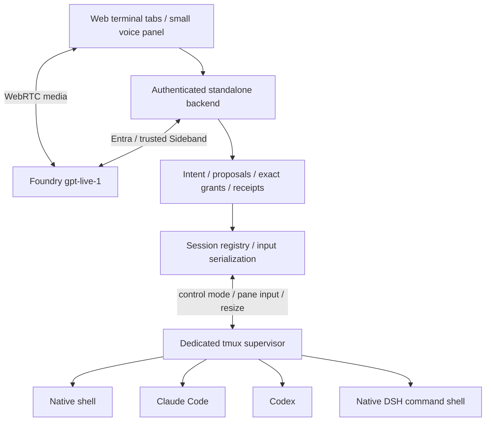

# ADR-0002：独立 Live Assistant 与持久终端会话

[English](0002-independent-live-assistant.md) | 简体中文

- 日期：2026-10-12
- 状态：Implemented；真实后端与语音切片已验证，真人中文/物理设备验收尚未完成。
- 取代范围：此前以 DSH 为宿主、通过 profile 与插件集中调度的语音原型（ADR-0001）。该原型已于 2026-10-14 移除（见文末“第三轮修订”），早于本仓库的公开历史。

## 决策

独立 Node Web 后端提供终端为主、语音为辅的工作区。GPT-Live 的 WebRTC 媒体与可信 Sideband 控制由 `live.mjs`（`FoundryLive`）实现，协议细节沿用此前已验证的接入经验；DSH、Codex、Claude 是同 VM 的原生命令执行者，不经过 DSH 子代理路由。

选择已有 **tmux 3.4** 作为 PTY 和进程监管器，Web 后端通过专属 socket 的 control mode 观察输出，通过真实 pane 输入和窗口尺寸 API 交互。tmux server 不依附浏览器/Web 后端的生命周期；后端退出只停止观察器，不终止 pane。没有引入 node-pty + 新常驻 supervisor，也没有把普通 stdout pipe 伪装成终端。

| 方案 | 决策理由 |
|---|---|
| tmux + control mode | 本机已有；保留 PTY、原生 shell/TUI、键鼠、进程存活和重新附着；无需新增系统服务 |
| node-pty + 独立 supervisor | 可行，但需要新的独立监管进程、协议及生命周期管理；本轮不必要 |
| Web 后端直接拥有普通子进程/输出重定向 | 不满足 TUI/PTY 和 Web 后端退出后的持久执行要求 |

## 组件与契约

`Sessions` 拥有稳定 UUID、工作目录、harness 类型、pane PID、运行/退出/丢失状态、递增观察版本和持久操作回执。WebSocket 客户端只附着一个选中终端；所有 session 独立运行。xterm/headless 与 serialize 保存有界观察窗口，xterm/browser 提供原生终端操作。重新附着使用标明缺口的快照，不缓存/重放键盘输入。慢客户端被断开后重新附着，不阻塞 harness。

同一用户的多个客户端可以观察；一个 session 同时只有一个键盘/resize 拥有者。明确“接管键盘”、实际键盘输入、resize、输出变化或授权撤销使旧的一次性决定失效。助手输入、用户输入和尺寸变更串行；批量文本与提交键分开，兼容原生 TUI 的 paste 检测。

观察器先以 `ignore-size` 附着，再在同一 control stream 内建立 capture/cursor 响应边界；边界前输出不与快照重复，边界后 delta 有序应用，消除独立 capture→attach 的丢失窗口。观察器不改变用户拥有者的 PTY 尺寸。终止后的历史快照不再读取不存在 pane 的鼠标 flag。键盘 UTF-8 与 xterm `onBinary` 鼠标字节分别传输。

## 管理与授权

tmux 3.4 偶发在原生进程已结束后无法给出 `pane_dead_status`；启动 shell 在等待原生命令退出后保存其实际返回码，监管层优先读取该回执。被强制终止且缺少回执时保持未知，不虚构零退出码。全屏重附着恢复 alternate buffer；鼠标模式从 tmux 原生 flag 恢复，因为纯屏幕 capture/xterm serialization 不完整携带这类模式。

GPT-Live delegation 没有参数。使用 `gpt-6.1-sol` 的有界、无工具、结构化 Responses 请求解释可信对话与 session 目录，形成 `new/input/append/modify/continue/verify/status/cancel/wait/pause/clarify` 提议；它不是新的通用执行 loop，也不依赖 DSH/Flash。解释错误阻止操作。状态查询不创建进程，也不因只读查询期间的正常输出变化被拒绝。

新建/终止提议有 UUID、时限和目标版本；代输入进一步绑定目标 session、快照 hash、准确字节、60 秒时限与操作 ID。用户按钮或明确语音“确认操作/拒绝操作”决定当前有效请求；在用户话语开始时捕获目标。助手输出、引用、终端文字和沉默都不授予权限。

用户可选择最多三次的短期精确输入授权；仅完全相同的快照与输入可再次使用，每次先持久化 prepared 回执再发送。用户接管、撤销、resize、到期或用完次数结束授权。原生 harness 的权限/沙箱不被 bypass；Claude 显式使用 native `default` permission mode，避免新版本默认 auto 模式改变原有人工确认边界。

`[y/N]` 等终端文本只能生成“可能等待确认”的提示和待授权输入，不视为原生结构化审批事实。全屏或其他不明确提示由用户直接操作，或明确请求助手输入；不推测选择键。纯终端跨进程交互无法保证与 CLI 状态变更原子提交，这一边界不能包装成强审批协议。

停止说话/静音/Live 关闭不终止 shell。wait 表示不给终端发送输入、等待用户意见，不承诺冻结运行中工作。取消显式关闭指定 tmux session，并核对原 pane 及已知子进程是否实际退出；仍有子进程则报 unknown，而不是宣称成功。进程退出码不是任务验收，终端中的“完成”不是权威结果。

明确的可信语音“等待用户意见/等待反馈/暂停当前会话”立即撤销话语开始时焦点 session 的自动输入授权，同一话语去重，不等意图推理。创建后台 session 不抢用户焦点。目录按有界片段同步；每批最多三个后台输出，剩余 session 延续排队，防止第四个饿死。传给模型的内容字段脱敏，但保留结构化 session/run 关联及用户终端原始交互。

## 托管 run 与验收事实

持久 processRunId 表示原生进程；每次授权的追加/修改/继续产生 managed run，保留 previousRunId 和 inputEpoch。旧 run 的 superseded 只表示结果有效性，不伪造底层取消。原生输出有 observationId、sequence 和 revision，taskRunId 明确为 null，不把混合终端内容强行归给当前任务。

用户明确提供并批准的独立命令在单独进程组执行，绑定 runId/inputEpoch；结果有实际退出码及 passed/failed/unknown/stale。最多两个并发、30 秒及 64 KiB 输出，本机 coreutils timeout 同时约束 Web 进程突然退出的情况。超限清理本次进程组；重复操作不重跑，重启 prepared 结果保持 unknown。迟到结果不能更新新 run 的成功状态；passed 仅证明该次验收命令，而非通用业务成功或完整费用。

## 原生模型路由

> 已被下文“第四轮修订”取代，本节仅作历史记录。

当时的实时语音、DeepSeek Flash、Codex 主模型与子代理模型部署经 Foundry 只读查询确认可用，且禁用 key authentication。真实请求另行核对，不将资源状态视为推理成功。

Codex/DSH wrapper 自己持有只监听 loopback 的短期路由代理；CLI 环境只得到随机本地代理认证值。代理每次转发通过 AzureCliCredential 获取当前 Entra token，绝不把真实 token 写入配置、参数、终端或 Web 返回值。配置、模型清单和路由可落盘，凭据只在内存/子进程环境。

- Codex 0.129.0：主模型 `gpt-6-astra`；实际版本使用 `agents.{default,worker,explorer}.config_file` 与 `description`，子配置选择 `gpt-6.1-sol`。已用真实 worker 请求核对两个模型均返回 HTTP 200。当前官方页面的 `agents.default_subagent_model` 与该安装版本不兼容，不能直接照搬。
- Codex 的 request compression 默认打开，本地代理不支持 zstd，显式关闭这一已存在的 feature；不改变全局用户配置。
- DSH 0.1.6-alpha.2 没有已安装的 `tui` profile。使用持久 bash 的 `dsh "task"` 原生命令、headless profile 和原生 session 日志，不声称具有不存在的 DSH TUI。Foundry Flash 拒绝官方 DeepSeek 私有 metadata，按原生配置关闭 `session-log-deepseek` 和 `plugin-package-inventory-deepseek` 的上传贡献，保留本地执行日志。
- Claude 2.1.283：当前安装用户与源配置用户相同，原配置就地复用；安装到新 home 时安全复制指定 settings 并保留已有 onboarding 字段。真实启动保留原生信任/renderer/权限提示，onboarding 并不替代实际认证。

官方配置背景：[Codex subagents](https://learn.chatgpt.com/docs/agent-configuration/subagents)；配置兼容性以本机 help、错误信息与真实请求为准。

## 恢复、安全与迁移

Web 后端重启重新观察已有 tmux pane，撤销所有旧 pending/grant，不重投命令。tmux/VM 重启导致原进程不存在时标记 lost，只保留历史和目录。元数据不是执行 checkpoint。

loopback HTTP 默认仅允许精确 Host/Origin；外部访问通过授权 SSH 隧道或 HTTPS 反向代理及显式 origin。密码在进程环境，登录 cookie 在内存且 HttpOnly/SameSite；登录和终端/Live 操作统一认证。静态资源本地提供，不用 CDN。

状态目录默认 `.live-assistant`。一个状态目录仅支持一个 Web 后端 writer，多浏览器共享它。（首轮的容量上限已由第二轮修订取消。）

## 第二轮修订（2026-10-13）：human-in-loop

本节取代上文中与之冲突的上限、时效与计次条款（60 秒提议时限、最多三次授权、两个并发/30 秒/64 KiB 验收、模型代理请求上限、Live 月度预算、会话/操作/回执数量上限）。

- **定位**：human-in-loop，由用户决定何时终止；不设执行次数、条数和时效上限，只保留防崩溃的字节级缓冲。注意力问题由主动上下文压缩解决（`text.mjs` 的 `condense` / `DeltaMemory`，只发送变化的目录和新增行，Live 转写折叠旧内容）。
- **统一提案**：`sessions.json` v2 保存 `proposals`（input / prompt / permission / create / cancel / close / verify），编号写作“N.”并在 1–99 间循环，可并存、任意顺序决定。授权纪元（`revision`）只因用户接管、等待反馈、进程结束而改变，输出与 spinner 不使提案失效；屏幕确认按问题区域锚定，提示离开屏幕才失效。
- **始终允许**：按 `(kind, key)` 的 session 级 grant，不计次、不限时，由撤销、等待反馈或进程结束清除。
- **原生 hook**：Claude Code / Codex 的 `PermissionRequest` hook（`hook.mjs`）经 `hook.sock` 把权限请求变成提案；`在终端处理`、socket 不可用或后端退出时 hook 不输出并退出 0，原生提示接管。
- **并发**：每 session 独立串行队列，全局队列只用于新建；对账使用一次 `list-panes -a`；输入走 control-mode `send-keys -H`。
- **事件日志**：`events.jsonl` 追加完整历史，`sessions.json` 只保留最近工作集。
- **解释器**：模型调用在队列外进行，结果提交时若纪元变化仅在卡片上标注，不丢弃请求；记录用量，不设调用上限。
- **Foundry 门面**：`foundry.mjs` 统一 Entra 凭据、端点校验与 TTS `createSpeech`（`/openai/v1/audio/speech`，默认 `gpt-4o-mini-tts`）；前端可朗读新提案。
- **验收**：超时可配（默认 10 分钟）、保留输出尾部、可取消。
- **接管与助手的优先级**（2026-10-15）：人的有意输入（按键、点击、粘贴、显式接管）优先于助手提案并使其失效；终端自动产生的鼠标移动/滚轮、焦点和应答不是人的决定，不使提案失效。显式“交还键盘”只释放拥有权。迟到的语音决定和失败的解释都回应对应 delegation，不以错误中断语音轮次。页面中卡片优先于报错显示。

## 第三轮修订（2026-10-14）：移除旧原型

- 删除以 DSH 为宿主的旧语音原型及其全部代码、脚本、测试、配置和文档：`packages/` 下除 `live-assistant` 以外的 8 个包、`profiles/voice`、TypeScript 构建配置、`voice:legacy`/`demo`/旧浏览器测试等 npm 脚本，以及 `VOICE_*`、`FOUNDRY_RESOURCE_GROUP`、`FOUNDRY_ACCOUNT_NAME`、`FOUNDRY_REASONING_DEPLOYMENT` 等配置项。仓库只剩 `packages/live-assistant` 一个工作区，不再需要构建步骤。
- 原先从旧包引用的 Live 适配器改为 `packages/live-assistant/src/live.mjs`（`FoundryLive`），只保留本助手使用的能力：创建不重试、`uncertain` 恢复、重新附着关闭、commentary/thinking 上下文、转写与委派事件、按 UTC 月份记录用量。预算、lease 和用量上限全部删除，用量只用于显示。状态文件从 `live-lease.json` 改为 `live.json`，旧文件不再读取（切换前所有本地记录均已是 closed）。
- npm 脚本：`assistant`、`test`（`tests/*.test.mjs`）、`test:browser`、`test:live`（付费）。`npm run voice` 别名删除。浏览器测试的 Chromium 路径改为 `LIVE_ASSISTANT_CHROMIUM`。
- 过期且依赖旧接口的 `scripts/smoke-assistant.mjs` 删除；真实 Claude/Codex/DSH 的端到端行为按[人工测试清单](../live-assistant.zh-CN.md#人工测试清单)验收。

## 第四轮修订（2026-10-14）：直接启动已安装的 harness

本节取代“原生模型路由”及上文中与之冲突的 harness 启动、配置与路由条款。

- 助手不再为 harness 配置 Foundry 模型路由、写入 CLI 配置、复制 onboarding 或运行 loopback 模型代理；`harness.json`、`model-requests.jsonl` 不再生成。harness 用的模型完全由各 CLI 自己的配置决定。
- harness 是当前 shell 中已安装的 CLI：`claude`、`codex`、`copilot` 无参数启动（Claude/Codex 只追加 PermissionRequest hook 参数），DSH 以 `dsh --profile dsh-tui` 启动 TUI，由用户按 Esc 后用 `/model` 选择模型。命令不在 PATH 中时下拉框显示“未找到”，新建与提案返回 409。
- 所有 session（含 shell）继承后端的环境变量（去掉 `npm run` 注入的部分）。环境只经 tmux `update-environment` 传给新 session，tmux server 自身以最小环境启动并设置 `exit-empty off`，因此变量值不进 argv、tmux 全局环境或状态文件。
- 可选的 `LIVE_ASSISTANT_DSH_FOUNDRY_TOKEN=1` 在每次新建 DSH 时用 AzureCliCredential 取 Entra token 并注入 `FOUNDRY_TOKEN`，等价于 `az account get-access-token --resource https://cognitiveservices.azure.com --subscription <subscription>`。这是长期端点就绪前的临时方案，token 约 1 小时过期，不自动刷新。
- 新建时选择默认目录 `<workspace>/<harness>-work` 或自定义目录；自定义目录必须位于工作区或 `LIVE_ASSISTANT_ROOTS` 列出的根目录（含子目录）之内，按路径和真实路径两次检查。
- 每个 tab 增加关闭按钮：终止进程（与顶部“终止进程”相同的确认流程）并把 session 标记为 `closed`，从界面与 Live 目录中移除。顶部“终止进程”保留，只终止不关闭。
- 界面改为 Fluent 风格的浅色主题。DSH 不再作为 devDependency 安装，测试前用 `nvm use 22` 让已安装的 `dsh` 进入 PATH。
