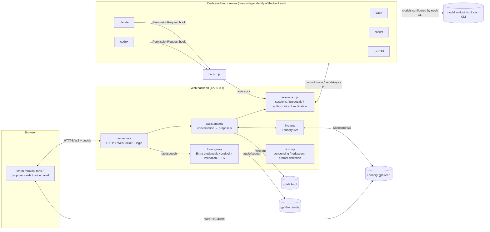
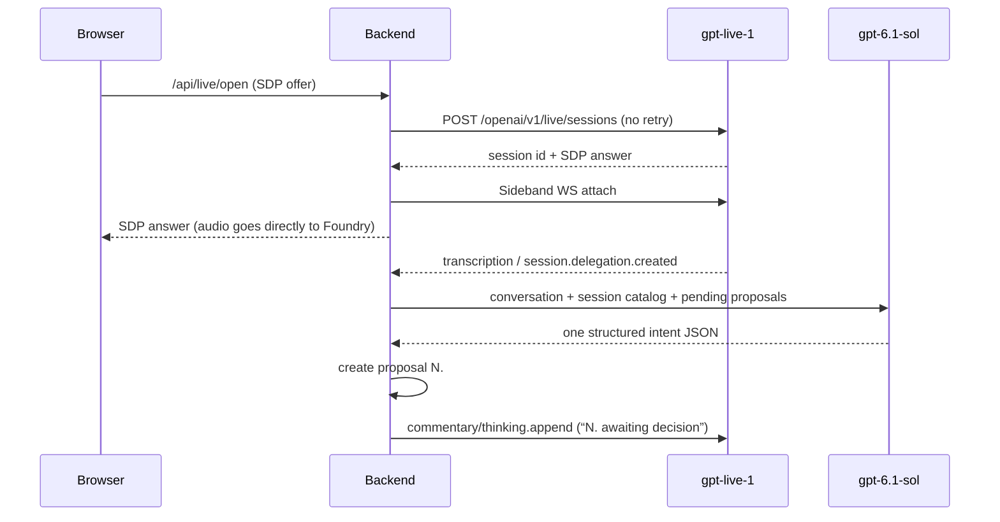

# Architecture

English | [简体中文](architecture.zh-CN.md)

Live Assistant is a single-process Node web backend (`packages/live-assistant`) plus a dedicated tmux server. The browser handles terminal display and voice media; the backend handles authentication, terminal observation, proposals and decisions, and model calls; tmux owns all CLI processes. For the design trade-offs see [ADR-0002](adr/0002-independent-live-assistant.md); for the security boundaries see the [threat model](threat-model.md).

## Components

| Module | Responsibility |
|---|---|
| `scripts/live-assistant.mjs` | Entry point: reads environment variables, calls `startAssistant`, and shuts down the backend on SIGINT/SIGTERM (without shutting down tmux) |
| `server.mjs` | Exact Host/Origin validation, password login (in-memory cookie, 8 hours), zod-validated JSON API, terminal WebSocket, static assets (including a local xterm, no CDN), state broadcast |
| `sessions.mjs` | tmux session lifecycle, control-mode observers and snapshots, keyboard owner, unified proposal table, always-allow grants, hook socket, independent verification processes, persistence and recovery |
| `assistant.mjs` | Live instructions, intent interpreter (`gpt-6.1-sol` structured output), voice decision parsing (“批准 N” (approve N), etc.), pushing condensed terminal progress to Live |
| `live.mjs` | `FoundryLive`: WebRTC session creation, Sideband control stream, transcription and delegation events, context injection, usage recording, recovery from uncertain creation |
| `foundry.mjs` | `AzureCliCredential` (a subscription can be specified), Foundry HTTPS root endpoint validation, `createSpeech` TTS |
| `harness.mjs` | Launch commands for shell/claude/codex/copilot/dsh (`defaultAdapters`), Claude/Codex hook arguments, optional temporary DSH token, inherited environment (`harnessEnvironment`) and PATH lookup (`findExecutable`) |
| `hook.mjs` | PermissionRequest hook invoked by the CLI: waits for the user's decision over `hook.sock`; on any failure it exits silently so the native prompt takes over |
| `keys.mjs` | Parsing and normalization of key proposals (key names, Ctrl/Alt/Shift combinations, rejecting combinations the terminal cannot distinguish) and step-by-step encoding (tmux key names or terminal bytes) |
| `text.mjs` | `condense` / `DeltaMemory` context condensing, `redact` redaction, `detectPrompt` on-screen confirmation detection |
| `store.mjs` | Atomic JSON writes (`.pending` + fsync + rename), serial queue, append-only event log |
| `public/` | Browser side: login, closable tabs, new-session dialog (working directory), xterm, proposal cards, voice (WebRTC), read-aloud toggle, independent verification form; Fluent-style light theme |

## Terminals and sessions

- Each session is a tmux session on a dedicated socket (`<STATE>/tmux.sock`, configured by `<STATE>/tmux.conf`); the backend observes output through control mode and writes bytes through `send-keys -H`. The tmux server is not tied to the backend: when the backend exits, only the observers stop; if there are no sessions when the backend exits, it shuts down the empty server.
- **Environment inheritance**: the tmux server is always started with a minimal environment (`PATH/HOME/LANG/TERM`) and configured with `exit-empty off`, so the global environment contains no user variables. On creation, a single tmux invocation runs `set -g update-environment <variable names…> ; new-session … ; set -gu update-environment`; the tmux client process's environment is the backend environment (`harnessEnvironment`: with the login password `LIVE_ASSISTANT_PASSWORD`, the `npm_*` variables injected by `npm run`, `INIT_CWD`, `NODE`, `COLOR` and the `node_modules/.bin` PATH prefix, as well as `TMUX`/`TMUX_PANE`, removed) plus the adapter's `env()` (e.g. DSH's `FOUNDRY_TOKEN`) and `LIVE_SESSION_ID`, `LIVE_HOOK_SOCKET`. These values enter only the new session's environment; they do not appear in argv, the tmux global environment, or the state files.
- **Working directory**: defaults to `<workspace>/<harness>-work`; a custom directory is resolved relative to the workspace and must lie within the workspace or `LIVE_ASSISTANT_ROOTS`, checked first by path and, after creation, again by real path (403). The directory is recorded in the session's `cwd`, and independent verification also runs in it.
- **File transfer**: `POST /api/upload?sessionId&name` (`application/octet-stream`, Origin checked) streams the request body into a hidden temporary file under the current working path, then publishes it under the target name with `link()` (409 if it already exists; no overwrite); on failure, on exceeding the limit (`uploadLimit`, 413), or on interruption, the temporary file is deleted; the file name must be a single name without directory separators. `GET /api/download?sessionId&path[&check]` resolves relative to the current working path and checks by real path that it lies within a root, serving only regular files (`check` returns only metadata, for the page's preflight check), and rejects requests whose `Sec-Fetch-Site` is not same-origin. The current working path is taken from tmux `pane_current_path`; when the process is not running, the session's `cwd` is used. After an upload completes, `Assistant.uploaded` tells Live the path and size as silent context, without reading the content.
- **Availability**: `harnesses()` looks up each adapter's command in the inherited PATH (briefly cached) and returns `{name, command, path, available}` in the state; creating or proposing an unavailable harness returns 409.
- **Closing a tab**: `closeTab` first goes through the same termination confirmation as “Terminate process” (`终止进程`), then marks the session `closed` and removes it from `list()`, the UI and the Live directory; if termination is not confirmed, the tab is not closed.
- The observer first attaches with `ignore-size`, then obtains the capture/cursor boundary within the same control stream, after which deltas are applied in order; on reattach a snapshot is used, and keyboard input is not replayed. Slow clients (buffer over 512 KiB) are disconnected and get a fresh snapshot on reconnect.
- A session has only one keyboard owner at a time; when nobody owns it, resize is decided by the page currently viewing it, and when there is an owner, only the owner's size is accepted. Typing or clicking automatically takes over the keyboard and invalidates the assistant's undecided input/key proposals in that session; mouse movement/wheel, focus and query responses generated by the terminal itself (`passiveInput`) are forwarded only from the owner or to a terminal that has no owner, without taking over the keyboard or changing the epoch. After the session ends, such reports (including clicks) are silently dropped, while typing still returns 409; the snapshot of an ended session ends by turning off mouse and focus reporting, so that modes left behind by a terminated TUI do not keep the page reporting. WebSocket `release` hands back the keyboard; it only removes the owner and does not restore proposals that were invalidated.
- Each session has its own serial queue; the global queue is used only for creation. Reconciliation uses a single `tmux list-panes -a`.
- The launch shell saves the actual exit code of the native command, which takes precedence when tmux occasionally fails to obtain `pane_dead_status`; if the process was forcibly killed and there is no receipt, the exit code stays unknown.
- On termination, the specified tmux session is closed, and `/proc` is used to verify that the original pane and its known child processes have exited; if anything remains, unknown is reported.

## Proposals and decisions

Every action that needs a human decision is a row in the same proposal table, with a number `N` (written as “N.” in display and in context; it cycles through 1–99, skipping numbers that are still pending/approved; lookup by number points to the proposal that most recently used that number):

| kind | Source | Effect after approval |
|---|---|---|
| `input` | Interpreter (append/modify/continue) or Web | Writes the exact bytes to the target session |
| `keys` | Interpreter (keys/key combinations named by the user) | Sends each step in order (`keys.mjs`): named keys (arrow keys, Home/End, PageUp/PageDown, Insert/Delete, F1–F12 and their Ctrl/Alt/Shift combinations, Enter/Esc/Tab/Backspace) use tmux key names and are encoded by tmux according to the pane's current mode; characters and their Ctrl/Alt combinations, as well as text, are written directly as bytes; 80 ms between steps |
| `prompt` | `[y/N]` prompts, CLI menus and trust dialogs recognized by `detectPrompt` | Writes the corresponding key |
| `permission` | Claude/Codex PermissionRequest hook | Replies allow/deny via `hook.sock`; with “Handle in terminal” (`在终端处理`) the hook outputs nothing and the native prompt takes over; answering in the terminal is handled the same way, and when focus is in that terminal the proposal is only hidden while the hook keeps waiting |
| `create` | Interpreter | Creates a session and delivers the initial task once the startup output has stabilized |
| `cancel` | Interpreter | Terminates the specified session |
| `close` | Interpreter | Terminates the specified session (if still running) and closes the tab, same as the × on the tab |
| `verify` | Interpreter or verification form | Runs the user-supplied command in an independent process group |

- The voice command “switch to a session” (`切到某 session`) (interpreter `focus`) is not a proposal: the assistant directly updates `focused` and increments `focusRequest`, and the page switches when that counter changes (not replayed on first load/reconnect); intents such as `input`/`create` that carry `focus: true` switch the same way, and a newly created session is switched to once it has been approved and started.
- **Attention**: when the terminal input box has focus and the window is in the foreground, the page reports `attention` over the WebSocket, and the backend records the focused clients per session (revoked on switching attachment or disconnecting); clicking a tab name puts focus into its terminal. A harness-originated `prompt`/`permission` that arises in a focused session, or that is already pending when focus moves in, is marked `quiet`: it does not appear in `pending()`, no `proposal` is broadcast, and for `permission` the hook keeps waiting; at the same time a `handled` event is emitted, and the assistant tells Live via silent context not to remind the user. When the last focus leaves, `quiet` proposals that are still pending lose the mark and are re-broadcast under their original numbers. When non-passive input is typed in the terminal (or “Handle in terminal” (`在终端处理`) is chosen), that session's pending proposals of these two kinds become `terminal`: the hook gives up, and the backend remembers the confirmation that was handed back (an anchor for on-screen confirmations, a wildcard for permission requests), and until the confirmation leaves the screen or the user presses Enter, the native prompt is not recognized as a new proposal again; for proposals that were not quiet, `handled` is emitted as well. Assistant-originated proposals are not affected.
- Multiple proposals can exist at the same time and be decided in any order. Ways to decide: buttons (approve/reject/always allow/handle in terminal), or the voice commands “批准 N / 拒绝 N / 始终允许 N” (approve N / reject N / always allow N) (Chinese numerals are supported; the number can be omitted when only one proposal is pending).
- The **authorization epoch** (`revision`) changes only when the user takes over the keyboard, asks to wait for feedback, or the process ends; program output and spinners do not invalidate proposals. On-screen confirmations are anchored to the question region and become invalid only when the prompt leaves the screen. If the epoch changes during interpretation, the card is annotated “You used this terminal while the request was being parsed” (`解析期间你操作过该终端`) instead of the request being discarded.
- **Always allow** is recorded on the session per `(kind, key)`, with no count or time limit; revocation, waiting for feedback or the process ending clears it, and it does not carry across sessions.
- The assistant's words, quoted words, terminal text and silence never constitute authorization. “Wait for feedback / wait for the user's input / pause the current session” (`等待反馈/等待用户意见/暂停当前会话`) immediately clears the focused session's always-allow grants and voids its pending proposals; it does not freeze the process.

## Voice and models

- **Live** (`live.mjs`): the creation POST is not idempotent; a timeout or an unparseable response is recorded as `uncertain`, which blocks automatic re-creation; the recorded state is `closed / creating / active / uncertain`, saved in `live.json`. When the backend restarts, an active session with a known session ID is closed by reattaching to it rather than by creating a new one. Context is injected through the commentary channel; when muted or silent it goes through the thinking channel. Provider `error` events carry no command ID, and control commands are sent serially, so such an event fails only the command currently awaiting an acknowledgment, and is published together with the code and the command type; when no command is in flight it is only reported and nothing fails. A new user utterance starts after each delegation; when transcription timestamps advance monotonically, a pause of ≥1.5 seconds also starts a new one; when there are no timestamps or the time base goes backwards (each segment counting from 0), delegations and assistant replies are used as the boundaries instead. utteranceId increases monotonically and is not reused across condensing or reconnects. Usage is recorded per UTC month as seconds and connection count, for display only, with no cap; a session that spans months counts only toward the month in which it started.
- **Intent interpreter**: a Responses request to the intent model (default `gpt-6.1-sol`, `reasoning.effort` default `low`), with no tools and a strict JSON schema; the intent types are `new/input/append/modify/continue/keys/verify/status/cancel/close/focus/wait/pause/clarify`, and a `keys` intent carries ordered `steps` (keys, or text without Enter). It only generates proposals and does not execute anything. Besides the conversation (for voice delegations, the recent conversation; for “Hand off to assistant” (`交给助手`), the raw text of the input box), its input includes summaries of all sessions, `running` (sessions that can accept input: id, name, note, harness), the pending proposals and `focused` (the page's current session, which receives follow-up input when no session is named). An `input/append/modify/continue` intent that lacks a target session or input text is converted to `clarify` by the backend, stating which one is missing; a trailing newline in the input text is stripped (Enter is appended on delivery), and input containing other invisible control characters is converted to `clarify`, asking for the key names to be said; `keys` is produced only when the user explicitly names the keys, and when the user only describes the effect (“quit vim” (`退出 vim`), “interrupt it” (`中断它`)) it asks which keys to press; a missing target, missing keys, or key combinations the terminal cannot distinguish (Ctrl+Enter, Shift+Esc, Ctrl+Shift+letter, etc.) are likewise converted to `clarify`. Clarifications for input-box requests are shown in the page's error bar, and Live is also told when voice is connected. Each interpretation logs one `assistant-intent` in `events.jsonl` (intent type, target ID, text length, number of key steps, the corresponding delegationId and the interpretation time `latencyMs`; no text or keys are recorded); a failed interpretation logs `assistant-intent-failed` (delegationId, elapsed time), with the reason in `assistant-error`. The request runs outside the session queue and does not block voice. Usage is written to `interpreter-usage.json`.
- **Voice diagnostics**: every delegation logs `delegation-received` (delegationId, utteranceId, text length). A delegation that is not passed to the interpreter logs `delegation-dropped` with a reason: `preview` (voice preview), `seen` (duplicate ID), `handled-utterance` (the client has already handled the same utterance directly); in the last case the delegation is still answered with context. A voice decision that did not take effect logs `voice-decision-missed` (number, proposal ID, reason: `missing`, `appeared-later`, `ambiguous`, `changed`, `decide-failed`, or the proposal's status at the time), and Live is informed; nothing is thrown. Provider errors log `live-error` (code, the command that was awaiting an acknowledgment at the time). `user-approved` / `user-rejected` carry `source` (`button` or `voice`). User and assistant transcript segments and delegation boundaries are written in arrival order to `live-transcript.jsonl` (each segment passed through `redact`, with timestamp, utteranceId and afterInput; delegations record only the text length); beyond 4 MiB it is rotated to `.1`. It is kept only on the local machine and is used to review voice requests that did not take effect.
- **TTS**: `/api/speech` calls `/openai/v1/audio/speech` (default `gpt-4o-mini-tts`); once “Read pending confirmations aloud” (`朗读待确认提醒`) is checked in the frontend, new cards are read aloud.
- **Context condensing**: terminal content sent to Live and to the interpreter first goes through `condense` (stripping ANSI, spinners, timers, borders and repeated lines), and `DeltaMemory` ensures that only new lines are sent for each session; the session catalog sends only changed entries; when the Live transcript exceeds 32,000 characters, older content is folded, and a delegation carries only the most recent complete conversation turns. The user's terminal itself keeps the raw output. Content fields passed to models go through `redact`.

The assistant's own models:

| Purpose | Deployment | Configuration |
|---|---|---|
| Live voice | `gpt-live-1`, voice `marin` | Resource `FOUNDRY_LIVE_ENDPOINT`; can be overridden with `FOUNDRY_LIVE_DEPLOYMENT`, `FOUNDRY_LIVE_VOICE` |
| Intent interpreter | `gpt-6.1-sol`, reasoning effort `low` | Resource `FOUNDRY_INTENT_ENDPOINT`; can be overridden with `FOUNDRY_INTENT_DEPLOYMENT` (`gpt-` deployments only), `FOUNDRY_INTENT_EFFORT` |
| Read-aloud | `gpt-4o-mini-tts`, voice `alloy` | Resource `FOUNDRY_TTS_ENDPOINT`; can be overridden with `FOUNDRY_TTS_DEPLOYMENT`, `FOUNDRY_TTS_VOICE` |

The models used by the harnesses are determined entirely by each CLI's own configuration; the assistant does not write to their configuration and does not provide a model proxy.

Each of the three specifies its own Foundry resource, so they can be spread across different regions (for example, live voice and read-aloud in one region and the intent interpreter in another).

All Foundry calls use an Entra token (audience `https://cognitiveservices.azure.com/`), not API keys. One token for a tenant is valid for all Foundry resources in that tenant; `AZURE_SUBSCRIPTION_NAME` is used only to let `AzureCliCredential` select the tenant, and access to each resource is determined by the RBAC on that resource.

## Harnesses

A harness is a CLI that the user has already installed and configured in the current shell; it is looked up on PATH and launched without extra arguments (only the hook arguments are appended). Every new session reads `~/.bashrc` as it is at that moment: `shell` itself is an interactive bash; the other harnesses are launched wrapped in `/bin/bash -ic 'exec "$0" "$@"'` (interactive mode is needed to get past the non-interactive `return` at the top of Ubuntu's rc, and `exec` preserves the exit code):

| harness | Launch |
|---|---|
| `shell` | `/bin/bash -i` |
| `claude` | `claude`; with hooks enabled, `--settings '<JSON>'` is appended to inject the PermissionRequest hook (a JSON string, not written to disk) |
| `codex` | `codex`; with hooks enabled, `-c hooks.PermissionRequest=...` is appended; the hook must be trusted inside the CLI the first time |
| `copilot` | `copilot`; no hook, the native permission menu produces `prompt` proposals through on-screen detection |
| `dsh` | `dsh --profile dsh-tui` (`LIVE_ASSISTANT_DSH_PROFILE`); in the TUI, press Esc and then use `/model` to choose a model; with `LIVE_ASSISTANT_DSH_FOUNDRY_TOKEN=1`, each creation uses `AzureCliCredential` (`AZURE_SUBSCRIPTION_NAME`) to obtain an Entra token that is injected as `FOUNDRY_TOKEN`; on failure, creation returns 409 with the reason |

Input that the assistant sends to a harness (including the initial task at creation) is always the verbatim text plus Enter; it is no longer wrapped as `dsh '<task>'`.

With `LIVE_ASSISTANT_HOOKS=0`, no hooks are injected, and permissions produce `prompt` proposals only through on-screen detection.

## Independent verification

Verification commands come only from the user (given explicitly in the form or by voice), run in an independent process group, and are bound to the session's runId and inputEpoch. The result is `passed / failed / unknown / stale`: new input makes a late result stale, a duplicate operation ID is not re-run, and verifications that were unfinished at restart are marked unknown. The timeout is set by `LIVE_ASSISTANT_VERIFY_TIMEOUT` (default 600 seconds); the tail of the output is kept, and a verification can be cancelled. `passed` only proves that this command passed.

Append, modify and continue, once approved, produce a new managed run, and the old run is marked `superseded` (this only describes the validity of results; it does not mean the underlying process was cancelled). `keys` proposals only operate the current task (menus, interrupts, editors) and do not create a new run, but like manual typing they increment inputEpoch. Native terminal output carries observationId and sequence, and is never guessed to be the completion event of a task.

## State and recovery

The state directory defaults to `.live-assistant` (`LIVE_ASSISTANT_STATE`), with permissions 700 and files 600:

| File | Contents |
|---|---|
| `sessions.json` | v2: session metadata, the working set of recent proposals/operations, grants (v1 is migrated automatically) |
| `events.jsonl` | Complete append-only event history |
| `live-transcript.jsonl` | Live transcript segments and delegation boundaries (redacted; rotated to `live-transcript.jsonl.1` at 4 MiB) |
| `live.json` | Live session records and monthly usage |
| `interpreter-usage.json` | Monthly interpreter request count and tokens |
| `tmux.sock`, `tmux.conf`, `hook.sock` | Runtime files (`runtime/<id>` left behind by older versions is deleted when the session ends) |
| `workspace/` | Workspace (`LIVE_ASSISTANT_WORKSPACE`); the default session directories `<harness>-work` live under it |

- **Backend restart**: existing tmux panes are observed again and those sessions' authorization epochs are bumped; pending proposals bound to a session are voided, approved proposals whose delivery was not confirmed are marked uncertain, and input is not re-delivered; Live sessions are handled according to `live.json` (see above).
- **tmux or VM restart**: sessions whose processes no longer exist are marked lost, and only their history is kept. Metadata is not an execution checkpoint.
- **Single writer**: a state directory can have only one backend process, while multiple browsers can share it. On startup, the backend first binds a Linux abstract socket named after the real path of the state directory and exits if the bind fails; when the process exits, the kernel releases the socket, leaving no stale lock.
- After a persistence failure, further changes are blocked until a manual recovery, rather than continuing with in-memory state that is inconsistent with the disk.

## Buffer limits

The system sets no limits on execution count, time or number of calls; it keeps only byte-level limits that prevent the process from crashing: 1,000,000 characters per input (the browser splits pastes into 4096-character chunks), 4 MiB per HTTP JSON request body, `LIVE_ASSISTANT_UPLOAD_MB` per uploaded file (default 2 GiB), 1 MiB per WebSocket message, 64 KiB per Live SDP, 1,200 characters per Live context item, and 4,000 characters of TTS text.
