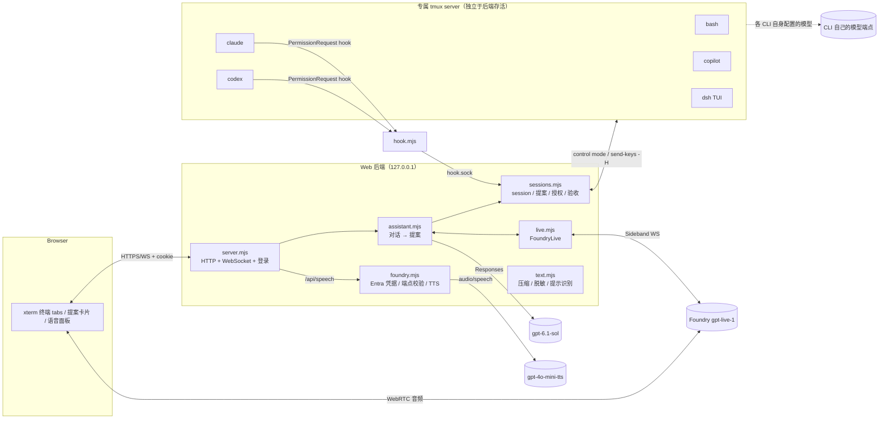
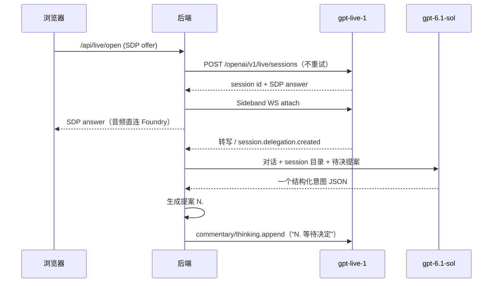

# 架构

[English](architecture.md) | 简体中文

Live Assistant 是一个单进程 Node Web 后端（`packages/live-assistant`），加上一个专属 tmux server。浏览器负责终端显示和语音媒体；后端负责认证、终端观察、提案与决策、模型调用；tmux 拥有所有 CLI 进程。设计取舍见 [ADR-0002](adr/0002-independent-live-assistant.zh-CN.md)，安全边界见[威胁模型](threat-model.zh-CN.md)。

## 组件

| 模块 | 职责 |
|---|---|
| `scripts/live-assistant.mjs` | 入口：读取环境变量，调用 `startAssistant`，SIGINT/SIGTERM 时关闭后端（不关闭 tmux） |
| `server.mjs` | 精确 Host/Origin 校验、密码登录（内存 cookie，8 小时）、zod 校验的 JSON API、终端 WebSocket、静态资源（含本地 xterm，无 CDN）、状态广播 |
| `sessions.mjs` | tmux session 生命周期、control-mode 观察器与快照、键盘拥有者、统一提案表、始终允许授权、hook socket、独立验收进程、持久化与恢复 |
| `assistant.mjs` | Live 指令、意图解释器（`gpt-6.1-sol` 结构化输出）、语音决策解析（“批准 N”等）、向 Live 推送压缩后的终端进展 |
| `live.mjs` | `FoundryLive`：WebRTC 会话创建、Sideband 控制流、转写与委派事件、上下文注入、用量记录、不确定创建的恢复 |
| `foundry.mjs` | `AzureCliCredential`（可指定订阅）、Foundry HTTPS 根端点校验、`createSpeech` TTS |
| `harness.mjs` | shell/claude/codex/copilot/dsh 的启动命令（`defaultAdapters`）、Claude/Codex hook 参数、可选的 DSH 临时 token、继承环境（`harnessEnvironment`）与 PATH 查找（`findExecutable`） |
| `hook.mjs` | CLI 调用的 PermissionRequest hook：经 `hook.sock` 等待用户决定，任何失败都静默退出，让原生提示接管 |
| `keys.mjs` | 按键提案的解析与规范化（键名、Ctrl/Alt/Shift 组合、拒绝终端无法区分的组合）和逐步编码（tmux 键名或终端字节） |
| `text.mjs` | `condense` / `DeltaMemory` 上下文压缩、`redact` 脱敏、`detectPrompt` 屏幕确认识别 |
| `store.mjs` | 原子写 JSON（`.pending` + fsync + rename）、串行队列、追加式事件日志 |
| `public/` | 浏览器端：登录、可关闭的 tab、新建对话框（工作目录）、xterm、提案卡片、语音（WebRTC）、朗读开关、独立验收表单；Fluent 风格浅色主题 |

## 终端与 session

- 每个 session 是专属 socket（`<STATE>/tmux.sock`，配置 `<STATE>/tmux.conf`）上的一个 tmux session，后端通过 control mode 观察输出，通过 `send-keys -H` 写入字节。tmux server 不依附后端：后端退出只停止观察器；没有 session 时后端退出会关闭空 server。
- **环境继承**：tmux server 总是用最小环境（`PATH/HOME/LANG/TERM`）启动并配置 `exit-empty off`，所以全局环境里没有用户变量。新建时在同一次 tmux 调用中执行 `set -g update-environment <变量名…> ; new-session … ; set -gu update-environment`，tmux client 进程的环境是后端环境（`harnessEnvironment`：去掉登录密码 `LIVE_ASSISTANT_PASSWORD`、`npm run` 注入的 `npm_*`、`INIT_CWD`、`NODE`、`COLOR` 和 `node_modules/.bin` PATH 前缀，以及 `TMUX`/`TMUX_PANE`）加上 adapter 的 `env()`（如 DSH 的 `FOUNDRY_TOKEN`）和 `LIVE_SESSION_ID`、`LIVE_HOOK_SOCKET`。这些值只进入新 session 的环境，不出现在 argv、tmux 全局环境或状态文件中。
- **工作目录**：默认 `<workspace>/<harness>-work`；自定义目录相对工作区解析，先按路径、创建后再按真实路径检查必须位于工作区或 `LIVE_ASSISTANT_ROOTS` 之内（403），目录记录在 session 的 `cwd` 中，独立验收也在该目录运行。
- **文件传输**：`POST /api/upload?sessionId&name`（`application/octet-stream`，校验 Origin）把请求体流式写入当前工作路径下的隐藏临时文件，再用 `link()` 发布为目标名（已存在时 409，不覆盖），失败、超限（`uploadLimit`，413）或中断都会删除临时文件；文件名必须是不含目录分隔符的单个名称。`GET /api/download?sessionId&path[&check]` 相对当前工作路径解析并按真实路径检查根目录，只提供普通文件（`check` 只返回元数据供页面预检），拒绝 `Sec-Fetch-Site` 非 same-origin 的请求。当前工作路径取 tmux `pane_current_path`，进程不在运行时用 session 的 `cwd`。上传完成后 `Assistant.uploaded` 以静默上下文告知 Live 路径与大小，不读取内容。
- **可用性**：`harnesses()` 在继承的 PATH 中查找每个 adapter 的命令（短暂缓存），状态中返回 `{name, command, path, available}`；不可用的 harness 新建或提案都返回 409。
- **关闭 tab**：`closeTab` 先走与“终止进程”相同的终止确认，再把 session 标记 `closed`，从 `list()`、界面与 Live 目录中移除；终止未确认时不关闭。
- 观察器先以 `ignore-size` 附着，再在同一 control 流里取得 capture/cursor 边界，之后的 delta 有序应用；重新附着时用快照，不重放键盘输入。慢客户端（缓冲超过 512 KiB）会被断开，重连后拿到新快照。
- 一个 session 同时只有一个键盘拥有者；resize 在无人拥有时由正在查看的页面决定，有拥有者时只接受拥有者的尺寸。用户打字或点击会自动接管键盘，并使该 session 中尚未决定的助手输入/按键提案失效；终端自身产生的鼠标移动/滚轮、焦点和查询应答（`passiveInput`）只转发给拥有者或无人拥有的终端，不接管、不改变纪元。session 结束后，这类上报（含点击）被静默丢弃，打字仍返回 409；结束 session 的快照末尾关闭鼠标与焦点上报，避免被终止的 TUI 留下的模式让页面持续上报。WebSocket `release` 交还键盘，只删除拥有者，不恢复已失效的提案。
- 每个 session 有独立的串行队列；全局队列只用于新建。对账用一次 `tmux list-panes -a`。
- 启动 shell 保存原生命令的实际退出码，tmux 偶发拿不到 `pane_dead_status` 时以它为准；被强制终止且没有回执时退出码保持未知。
- 终止时关闭指定 tmux session，并通过 `/proc` 核对原 pane 及已知子进程是否退出；仍有残留时报 unknown。

## 提案与决策

所有需要人决定的动作都是同一张提案表中的一行，带编号 `N`（显示与上下文中写作“N.”，在 1–99 间循环并跳过仍为 pending/approved 的编号；按编号查找时指向最近一次使用该编号的提案）：

| kind | 来源 | 批准后的效果 |
|---|---|---|
| `input` | 解释器（追加/修改/继续）或 Web | 把准确字节写入目标 session |
| `keys` | 解释器（用户点名的按键/组合键） | 按顺序发送每一步（`keys.mjs`）：命名键（方向键、Home/End、PageUp/PageDown、Insert/Delete、F1–F12 及其 Ctrl/Alt/Shift 组合，Enter/Esc/Tab/Backspace）用 tmux 键名，由 tmux 按 pane 当前模式编码；字符及其 Ctrl/Alt 组合、文本直接写字节；步间隔 80 ms |
| `prompt` | `detectPrompt` 识别的 `[y/N]`、CLI 菜单、信任对话框 | 写入对应按键 |
| `permission` | Claude/Codex 的 PermissionRequest hook | 通过 `hook.sock` 回复 allow/deny；“在终端处理”则 hook 不输出，原生提示接管；在终端里回答时同样处理，焦点在该终端时只隐藏、hook 继续等待 |
| `create` | 解释器 | 新建 session，启动输出稳定后送达初始任务 |
| `cancel` | 解释器 | 终止指定 session |
| `close` | 解释器 | 终止指定 session（如仍在运行）并关闭 tab，与 tab 上的 × 相同 |
| `verify` | 解释器或验收表单 | 在独立进程组运行用户给出的命令 |

- 语音“切到某 session”（解释器 `focus`）不是提案：助手直接更新 `focused` 并递增 `focusRequest`，页面在该计数变化时切换（首次加载/重连不重放）；`input`/`create` 等意图带 `focus: true` 时同样切换，新建的在批准且启动后切换。
- **注意力**：页面在终端输入框获得焦点且窗口在前台时经 WebSocket `attention` 上报，后端按 session 记录有焦点的客户端（切换附着或断线即撤销）；点击 tab 名称即把焦点放进其终端。harness 发起的 `prompt`/`permission` 在有焦点的 session 中产生时，或焦点移入时已待决的，标为 `quiet`：不出现在 `pending()`、不广播 `proposal`，`permission` 的 hook 继续等待；同时发出 `handled` 事件，助手以静默上下文告诉 Live 不要提醒。最后一个焦点离开时，仍待决的 `quiet` 提案去掉标记、以原编号重新广播。在终端中打出非被动输入（或选择“在终端处理”）时，该 session 待决的这两类提案转为 `terminal`：hook 放弃，后端记住已交还的确认（屏幕确认记 anchor，权限请求记通配），直到确认离开屏幕或用户按下回车前不再把原生提示识别成新提案；非 quiet 的再发 `handled`。助手发起的提案不受影响。
- 多张提案可以同时存在，按任意顺序决定。决定方式：按钮（批准/拒绝/始终允许/在终端处理），或语音“批准 N / 拒绝 N / 始终允许 N”（支持中文数字；只有一张待决时可省略编号）。
- **授权纪元**（`revision`）只在用户接管键盘、等待反馈或进程结束时改变；程序输出和 spinner 不会使提案失效。屏幕确认按问题区域锚定，提示离开屏幕才失效。解释期间纪元变化时，卡片会标注“解析期间你操作过该终端”，而不是丢弃请求。
- **始终允许**按 `(kind, key)` 记在 session 上，不计次、不限时；撤销、等待反馈或进程结束会清除它，且不跨 session。
- 助手的话、引用的话、终端文字和沉默都不构成授权。“等待反馈/等待用户意见/暂停当前会话”立即清除焦点 session 的始终允许，并作废其待决提案；它不冻结进程。

## 语音与模型

- **Live**（`live.mjs`）：创建 POST 不是幂等的，超时或无法解析的响应记为 `uncertain`，阻止自动重建；记录状态为 `closed / creating / active / uncertain`，保存在 `live.json`。后端重启时，已知 session ID 的活跃会话通过重新附着来关闭，而不是新建。上下文通过 commentary 通道注入；静音或 silent 时走 thinking 通道。Provider 的 `error` 事件不带命令 ID，控制命令串行发送，所以它只让正在等待回执的那条命令失败，并连同 code 和命令类型发布；没有在途命令时只报告、不让任何东西失败。用户话轮（utterance）在委派后另起；转写时间戳单调前进时，停顿 ≥1.5 秒也另起；没有时间戳或时间基准回退（每段从 0 计）时，改以委派和助手回复为边界。utteranceId 单调递增，压缩和重连都不复用。用量按 UTC 月份记录秒数和连接次数，只用于显示，没有上限；跨月会话只计入开始的月份。
- **解释器**：意图模型（默认 `gpt-6.1-sol`，`reasoning.effort` 默认 `low`）的 Responses 请求，无工具、严格 JSON schema，意图类型为 `new/input/append/modify/continue/keys/verify/status/cancel/close/focus/wait/pause/clarify`，`keys` 意图带有序的 `steps`（按键或不回车的文本）。它只生成提案，不执行。输入除对话（语音委派为最近对话，“交给助手”为输入框原文）外，还有全部 session 摘要、`running`（可接收输入的 session：id、名称、备注、harness）、待决提案和 `focused`（页面当前 session，未点名时后续输入发给它）。缺目标 session 或输入文本的 `input/append/modify/continue` 意图在后端转为 `clarify`，说明缺哪一项；输入文本末尾的换行被去掉（送达时追加 Enter），含其他不可见控制字符的输入转为 `clarify`，要求说出键名；`keys` 只在用户明确说出键名时产生，只描述效果（“退出 vim”“中断它”）时澄清要按哪些键，缺目标、缺按键或终端无法区分的组合键（Ctrl+Enter、Shift+Esc、Ctrl+Shift+字母等）同样转为 `clarify`。输入框请求的澄清显示在页面报错栏，连着语音时也告诉 Live。每次解释在 `events.jsonl` 记一条 `assistant-intent`（意图类型、目标 ID、文本长度、按键步数、对应的 delegationId 和解释耗时 `latencyMs`，不记文本和按键）；解释失败记 `assistant-intent-failed`（delegationId、耗时），原因在 `assistant-error`。请求在 session 队列之外进行，不阻塞语音。用量写入 `interpreter-usage.json`。
- **语音诊断**：每次委派记 `delegation-received`（delegationId、utteranceId、文本长度）。不交给解释器的委派记 `delegation-dropped` 及原因：`preview`（语音预览）、`seen`（重复 ID）、`handled-utterance`（客户端已直接处理过同一句话）；后一种仍以 context 应答该 delegation。没生效的语音决定记 `voice-decision-missed`（编号、提案 ID、原因：`missing`、`appeared-later`、`ambiguous`、`changed`、`decide-failed` 或提案当时的状态），并告知 Live，不抛出。Provider 错误记 `live-error`（code、当时等待回执的命令）。`user-approved` / `user-rejected` 带 `source`（`button` 或 `voice`）。用户和助手的转写片段、委派边界按到达顺序写入 `live-transcript.jsonl`（逐段 `redact`，含时间戳、utteranceId 和 afterInput，委派只记文本长度），超过 4 MiB 时轮转为 `.1`，只保存在本机，用于复盘没生效的语音请求。
- **TTS**：`/api/speech` 调用 `/openai/v1/audio/speech`（默认 `gpt-4o-mini-tts`），前端勾选“朗读待确认提醒”后朗读新卡片。
- **上下文压缩**：发给 Live 和解释器的终端内容先经过 `condense`（去 ANSI、spinner、计时器、边框和重复行），`DeltaMemory` 保证每个 session 只发送新增行；session 目录只发送变化项；Live 转写超过 32,000 字符时折叠旧内容，委派时只带最近的完整对话轮次。用户终端本身保留原始输出。传给模型的内容字段经过 `redact`。

助手自身的模型：

| 用途 | 部署 | 配置 |
|---|---|---|
| 实时语音 | `gpt-live-1`，音色 `marin` | 资源 `FOUNDRY_LIVE_ENDPOINT`；`FOUNDRY_LIVE_DEPLOYMENT`、`FOUNDRY_LIVE_VOICE` 可覆盖 |
| 意图解释 | `gpt-6.1-sol`，思考强度 `low` | 资源 `FOUNDRY_INTENT_ENDPOINT`；`FOUNDRY_INTENT_DEPLOYMENT`（仅 `gpt-` 部署）、`FOUNDRY_INTENT_EFFORT` 可覆盖 |
| 朗读 | `gpt-4o-mini-tts`，音色 `alloy` | 资源 `FOUNDRY_TTS_ENDPOINT`；`FOUNDRY_TTS_DEPLOYMENT`、`FOUNDRY_TTS_VOICE` 可覆盖 |

harness 使用的模型完全由各 CLI 自己的配置决定，助手不写入它们的配置、不提供模型代理。

三者各自指定 Foundry 资源，可以分布在不同 region（例如实时语音和朗读在一个 region，意图解释在另一个）。

所有 Foundry 调用都用 Entra token（audience `https://cognitiveservices.azure.com/`），不使用 API key。同一 tenant 的一个 token 对该 tenant 内所有 Foundry 资源有效，`AZURE_SUBSCRIPTION_NAME` 只用于让 `AzureCliCredential` 选定 tenant，各资源的访问由其上的 RBAC 决定。

## Harness

harness 是用户在当前 shell 中已安装并配置好的 CLI，按 PATH 查找，无额外参数启动（只追加 hook 参数）。每个新 session 都读取当时的 `~/.bashrc`：`shell` 自身是交互式 bash；其余 harness 经 `/bin/bash -ic 'exec "$0" "$@"'` 包装启动（交互模式才能越过 Ubuntu rc 开头的非交互 `return`，`exec` 保留退出码）：

| harness | 启动方式 |
|---|---|
| `shell` | `/bin/bash -i` |
| `claude` | `claude`；启用 hook 时追加 `--settings '<JSON>'` 注入 PermissionRequest hook（JSON 字符串，不落盘） |
| `codex` | `codex`；启用 hook 时追加 `-c hooks.PermissionRequest=...`，首次需在 CLI 内信任该 hook |
| `copilot` | `copilot`；无 hook，原生权限菜单由屏幕识别产生 `prompt` 提案 |
| `dsh` | `dsh --profile dsh-tui`（`LIVE_ASSISTANT_DSH_PROFILE`），TUI 中按 Esc 后用 `/model` 选择模型；`LIVE_ASSISTANT_DSH_FOUNDRY_TOKEN=1` 时每次新建用 `AzureCliCredential`（`AZURE_SUBSCRIPTION_NAME`）取 Entra token 注入 `FOUNDRY_TOKEN`，失败时新建返回 409 并说明原因 |

助手发给 harness 的输入（含新建时的初始任务）都是原样文本加回车，不再包装成 `dsh '<task>'`。

`LIVE_ASSISTANT_HOOKS=0` 时不注入 hook，权限只通过屏幕识别产生 `prompt` 提案。

## 独立验收

验收命令只来自用户（表单或语音中明确给出），在独立进程组中运行，绑定 session 的 runId 和 inputEpoch。结果是 `passed / failed / unknown / stale`：新的输入使迟到结果变为 stale，重复 operation ID 不重跑，重启后未完成的验收标为 unknown。超时由 `LIVE_ASSISTANT_VERIFY_TIMEOUT` 设置（默认 600 秒），输出保留尾部，可以取消。`passed` 只证明这条命令通过。

追加、修改、继续经批准后产生新的 managed run，旧 run 标为 `superseded`（只表示结果有效性，不代表底层进程被取消）。`keys` 提案只操控当前任务（菜单、中断、编辑器），不新建 run，但与人工打字一样递增 inputEpoch。终端原生输出带 observationId 和 sequence，不会被猜测为某个任务的完成事件。

## 状态与恢复

状态目录默认 `.live-assistant`（`LIVE_ASSISTANT_STATE`），权限 700，文件 600：

| 文件 | 内容 |
|---|---|
| `sessions.json` | v2：session 元数据、最近的提案/操作工作集、授权（v1 自动迁移） |
| `events.jsonl` | 追加式完整事件历史 |
| `live-transcript.jsonl` | Live 转写片段与委派边界（脱敏，4 MiB 轮转为 `live-transcript.jsonl.1`） |
| `live.json` | Live 会话记录与月度用量 |
| `interpreter-usage.json` | 解释器月度请求数与 token |
| `tmux.sock`、`tmux.conf`、`hook.sock` | 运行时文件（旧版本留下的 `runtime/<id>` 在 session 结束时删除） |
| `workspace/` | 工作区（`LIVE_ASSISTANT_WORKSPACE`），默认 session 目录 `<harness>-work` 在其下 |

- **后端重启**：重新观察已有 tmux pane，并提升这些 session 的授权纪元；绑定 session 的待决提案作废，已批准但未确认送达的提案标为 uncertain，不重投输入；Live 会话按 `live.json` 处理（见上文）。
- **tmux 或 VM 重启**：进程已不存在的 session 标为 lost，只保留历史。元数据不是执行 checkpoint。
- **单写者**：一个状态目录只能有一个后端进程，多个浏览器可以共享。后端启动时先绑定以状态目录真实路径命名的 Linux abstract socket，绑定失败即退出；进程退出时内核释放它，不留陈旧锁。
- 持久化失败后，后续变更会被阻止，直到人工恢复，而不是在内存状态与磁盘不一致的情况下继续。

## 缓冲上限

系统不设执行次数、时效或调用次数上限，只保留防止进程崩溃的字节级限制：单次输入 1,000,000 字符（浏览器把粘贴按 4096 字符分片）、HTTP JSON 请求体 4 MiB、单个上传文件 `LIVE_ASSISTANT_UPLOAD_MB`（默认 2 GiB）、WebSocket 消息 1 MiB、Live SDP 64 KiB、单条 Live 上下文 1,200 字符、TTS 文本 4,000 字符。
